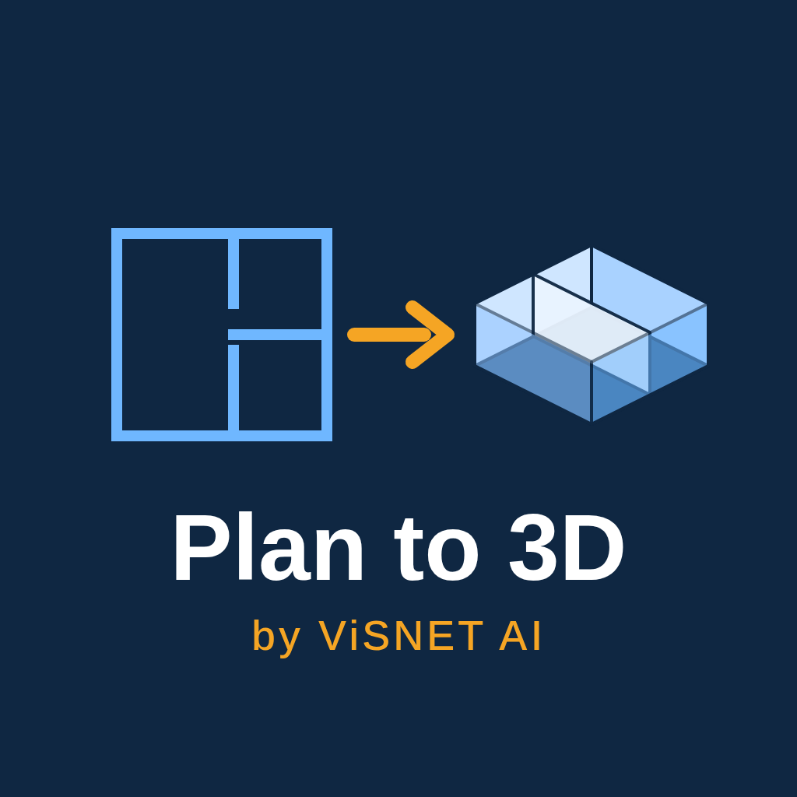

<p align="center"></p>

# Plan to 3D

A Cursor / Grok Bot plugin by [ViSNET AI](https://visnetai.co) that turns 2D drawings into 3D models you can open, view, print, and use.

Give the agent a floor plan, site plan, part profile, or logo (**DXF**, vector **PDF**, **SVG**, **PNG** or **JPG**). It builds the 3D model and returns:

- **GLB** (browser, Windows 3D Viewer, AR), **STL** (3D printing), **OBJ** (Blender, SketchUp), **STEP** (Fusion, SolidWorks, FreeCAD)
- a **PNG preview** and, on request, a one-file **HTML 3D viewer**
- a **quantity report**: wall centreline length, wall footprint area, wall volume, area of every enclosed room, a rough concrete and brick estimate, and a scale check

Everything runs locally in Python (ezdxf, shapely, trimesh, OpenCV, PyMuPDF, svgelements, build123d). Drawings are never uploaded anywhere. All quantities are approximate, for planning only.

## What's inside

```
.cursor-plugin/plugin.json        plugin manifest
skills/plan-to-3d/SKILL.md        the agent skill (workflow, scale rules, checks, reply format)
skills/plan-to-3d/scripts/        plan_to_3d.py converter, selftest.py, requirements.txt
skills/plan-to-3d/samples/        sample DXF / PDF / PNG plan and SVG profile (+ make_samples.py)
assets/logo.svg, assets/logo.png  logo
```

## Testing

1. Install the plugin in Cursor or Grok Bot, or clone this repo.
2. In `skills/plan-to-3d/`:
   ```bash
   python3 -m venv .venv && .venv/bin/pip install -r scripts/requirements.txt
   .venv/bin/python scripts/selftest.py
   ```
   Expected: `PASS` for dxf, pdf, png and svg, then `ALL PASS`. The sample plan is 10 m × 7 m with three rooms, and the test checks the room areas (39.4, 12.5 and 12.5 m²) within 3%, that every mesh is watertight, and that all output files are written.
3. In the agent, attach `skills/plan-to-3d/samples/sample_plan.dxf` and ask: *"Turn this floor plan into a 3D model."* The agent should return GLB, STL, OBJ, STEP and a preview, report a 10.2 × 7.2 × 3.0 m model with three rooms (about 39.3, 12.5 and 12.5 m²), and state the 3 m wall height and 0.20 m wall thickness it assumed.
4. Attach `sample_plan.png` and ask the same. The agent should ask for one known dimension (for example the front wall is 10 m wide) before building.

Manual run:

```bash
.venv/bin/python scripts/plan_to_3d.py samples/sample_plan.dxf --html --out out
.venv/bin/python scripts/plan_to_3d.py samples/sample_plan.png --scale 0.02 --out out
.venv/bin/python scripts/plan_to_3d.py samples/sample_profile.svg --kind profile --height 0.005 --scale 0.001 --out out
```

## Limits

- DWG is not read directly; export DXF from your CAD app.
- Raster scans and photos need one known dimension for scale, and hand sketches come out rough.
- Mechanical multi-view drawings are built by the agent with build123d after you confirm the dimensions; they are not fully automatic.
- It does not design new plans, render photoreal interiors, or produce structural designs or tender quantities.

## License

MIT © 2026 Visnet AI Technology Private Limited. Contact: krishna.ceo@visnetai.co
